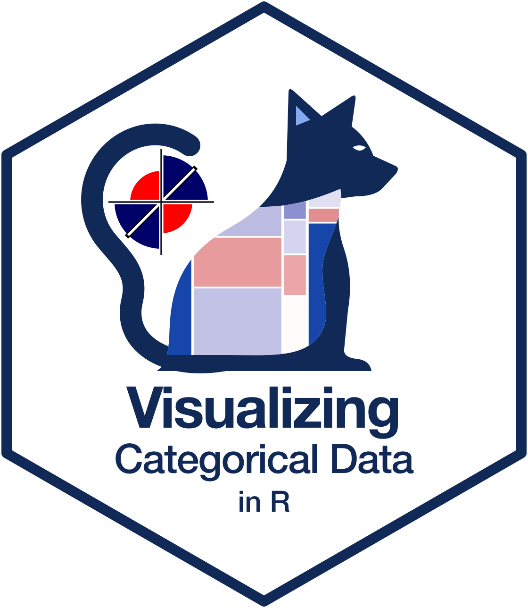
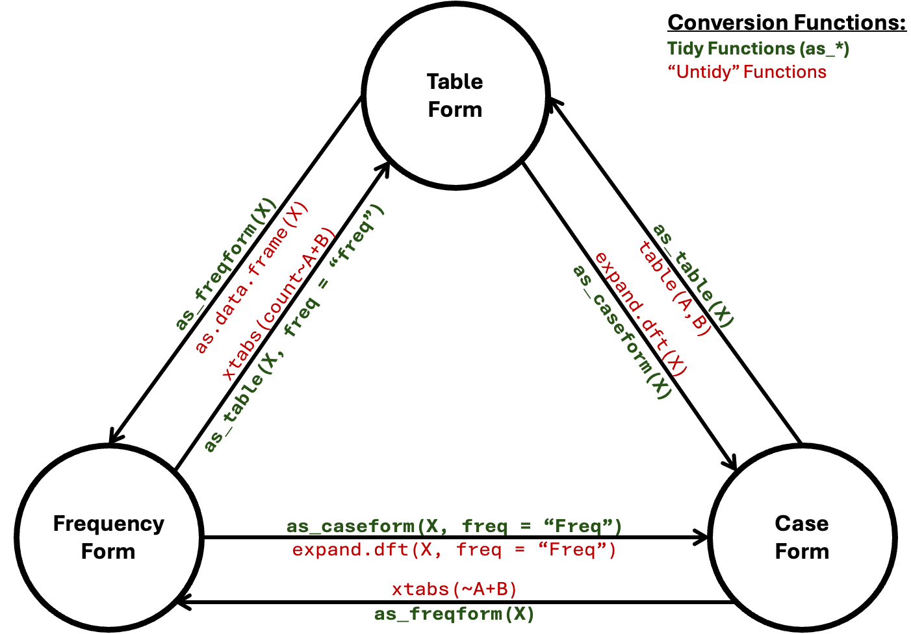
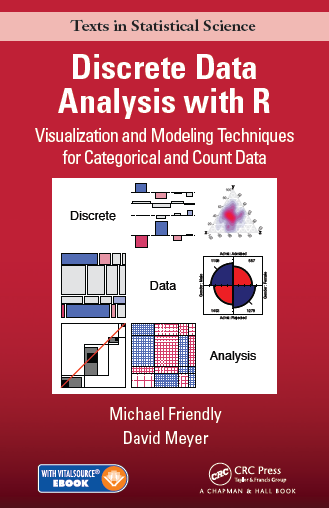

```{r}
#| label: setup
#| echo: FALSE

library(gt)
library(ggplot2)
library(ggmosaic2)
```

## Agenda

:::: {.columns align=center}
::: {.column width="60%"}
```{=latex}
% Same contents as Quarto's automatic `toc: true` slide (sections only),
% with a smaller gap between entries so all of them fit above the footer
\compacttoc{1em}
```
:::
::: {.column width="40%"}

:::
::::

## R Packages Needed

```{=latex}
\begin{columns}[T]
\hexpkg{images/hex/ggplot2.png}{ggplot2}{Wickham}{2016}
\hexpkg{images/hex/vcdExtra.png}{vcdExtra}{Friendly \& Klorfine}{2026}
\hexpkg{images/hex/ggmosaic2.png}{ggmosaic2}{Friendly et al.}{2026}
\hexpkg{images/hex/ggfourfold.png}{ggfourfold}{Klorfine \& Friendly}{2026}
\end{columns}
\vskip1.5em
```

```{r}
#| label: install
#| eval: FALSE
install.packages(c("ggplot2", "vcdExtra",
                   "ggmosaic2", "ggfourfold"))
```

# Forms of Categorical Data in R

## The `HairEyeColor` Data

The `HairEyeColor` data is a classic data set in categorical data analysis (CDA) and will be used as one of the running examples in this workshop. *It is installed in R by default and can be accessed by running* `HairEyeColor`.

```{r}
#| label: HEC-table
#| echo: false

library(gt)

hec <- as.data.frame(HairEyeColor) |>
  tidyr::pivot_wider(names_from = c(Sex, Eye), values_from = Freq)

tbl <- gt(hec, rowname_col = "Hair") |>
  # Spanners name the column variable (Eye) as well as the Sex split
  tab_spanner("Eye (Male)", columns = starts_with("Male")) |>
  tab_spanner("Eye (Female)", columns = starts_with("Female")) |>
  cols_label_with(fn = \(x) sub(".*_", "", x)) |>  # "Male_Brown" -> "Brown"
  tab_stubhead(label = "Hair") |>
  # Shade counts on one shared scale (0 to the largest cell) so cells compare across columns
  data_color(columns = -Hair, palette = c("white", "#7FA7AB"),
             domain = c(0, max(HairEyeColor))) |>
  tab_style(style = cell_text(weight = "bold"),
            locations = list(cells_column_spanners(), cells_stubhead())) |>
  tab_options(table.font.size = px(15))

# gt always emits a stretched tabular* in LaTeX, which knocks the cell shading out of
# line with the columns. Swap it for a plain tabular (natural width), and drop the
# vertical rule after the Hair column while we're at it.
tex <- as_latex(tbl)
tex[] <- sub("\\begin{tabular*}{\\linewidth}{@{\\extracolsep{\\fill}}l|",
             "\\begin{tabular}{l", tex, fixed = TRUE)
tex[] <- sub("\\end{tabular*}", "\\end{tabular}", tex, fixed = TRUE)
tex
```

## Table Form

Categorical Data in R can take a few different forms. The `HairEyeColor` data comes in **table form**:

```{r}
#| label: HEC-dat
#| eval: false

HairEyeColor
```

<!-- The full printout is too tall for one slide, so show it as two side-by-side
     slices; drop = FALSE keeps R's ", , Sex = ..." header so it reads as the real output -->
```{=latex}
\small
```

:::: {.columns}
::: {.column width="50%"}
```{r}
#| label: HEC-dat-male
#| echo: false
HairEyeColor[, , "Male", drop = FALSE]
```
:::
::: {.column width="50%"}
```{r}
#| label: HEC-dat-female
#| echo: false
HairEyeColor[, , "Female", drop = FALSE]
```
:::
::::
   
## Frequency Form

When working with `ggplot2` and related packages, data needs to be either in **frequency** or **case form**.

To convert from table -> frequency form:

```{r}
#| label: table-to-freq
#| eval: false

as.data.frame(HairEyeColor) |>  # Convert to frequency form
   head()                       # Check first few rows
```

```{=latex}
\begin{centerout}
```

```{r}
#| label: table-to-freq-out
#| echo: false
as.data.frame(HairEyeColor) |>
   head()
```

```{=latex}
\end{centerout}
```

\vspace{1em}

Note the presence of a frequency column, `Freq`.

## Case Form

As mentioned, there is also **case form**, where each observation is given its own row.

To convert from table -> case form:

```{r}
#| label: table-to-case
#| eval: false

vcdExtra::expand.dft(HairEyeColor) |>  # Convert
   dplyr::slice_sample(n = 5)  # Display 5 rows at random
```

```{=latex}
\begin{centerout}
```

```{r}
#| label: table-to-case-out
#| echo: false
vcdExtra::expand.dft(HairEyeColor) |>  # Convert
   dplyr::slice_sample(n = 5)     # Display 5 rows at random
```

```{=latex}
\end{centerout}
```

\vspace{1em}

Like frequency form, case form data are still `data.frame`s; however, the `Freq` column is omitted since each row would have `Freq = 1`.

## Conversions

The process of converting amongst forms depends both on (a) the current form, and (b) the target form. The diagram on the next slide shows which function to use and when.

In the diagram, `X` represents an R data object, with `A`, `B`, and `C` representing categorical variables.

## Conversions

{width=90% fig-align="center"}

## Conversions

In the diagram, \textcolor{untidyred}{red functions} are all in base R, with the exception of `vcdExtra::expand.dft()`

The \textcolor{tidygreen}{green functions} are ones I have developed in `vcdExtra` to try and make the conversion process less of a headache.

Either \textcolor{untidyred}{red} or \textcolor{tidygreen}{green} functions will work, and the choice of which to use is up to you (though if you run into any errors with the \textcolor{tidygreen}{green} ones, let me know!).

:::{.callout-note}
When converting *from* frequency form *to* a different form, it is usually necessary to specify which column holds the cell frequencies (usually `Freq` or `count`). See the diagram.
:::

# `ggplot2`: A Basic Overview

## Constructing a Plot

The `ggplot2` R package contains a system for visualizing data that is known as the "Grammar of Graphics" (the 'gg' in `ggplot2`).

- Plots are constructed using aesthetics (`ggplot2::aes()`) and layers
- This is best shown through a worked example
   + Let's construct a bar graph of the `HairEyeColor` data

## Bar Graph

First, let's convert our data into frequency form so that we may use `ggplot2`:

```{r}
#| label: HEC-freq

hec <- as.data.frame(HairEyeColor)
```

Next, let's construct the graph step-by-step:

## Bar Graph

- All `ggplot2` graphs first start with a call to `ggplot()`
- The first argument is the dataset
- The second argument is a list of aesthetic mappings
   + E.g., what should the $x$-axis be? The $y$-axis? Is there any grouping needed?
   + Done through the `ggplot2::aes()` function

```{r}
#| label: bar1
#| eval: FALSE

library(ggplot2)

ggplot(hec, aes(...))
```

## Mapping a Variable to $x$ in `aes()`

:::: {.columns align=center}
::: {.column width="45%"}
```{r}
#| label: map-x
#| eval: false

ggplot(hec, aes(x = Hair))
```

\vspace{0.5em}

- `Hair` is mapped to the $x$-axis
- No `geom` yet, so we get a blank canvas

:::
::: {.column width="55%"}
```{r}
#| label: map-x-plot
#| echo: false
#| fig-width: 3.2
#| fig-height: 3
#| out-width: 100%

ggplot(hec, aes(x = Hair))
```
:::
::::

## Using a `geom`

:::: {.columns align=center}
::: {.column width="45%"}
```{r}
#| label: use-geom
#| eval: false

ggplot(hec, aes(x = Hair)) +
   geom_bar()
```

\vspace{0.5em}

- A `geom` is how you draw on the canvas. There are different `geom`s for different plot types
- For bar graphs, there is `geom_bar()`
- `geom`s are added (via the `+` operator) to the initial `ggplot()` call

:::
::: {.column width="55%"}
```{r}
#| label: use-geom-plot
#| echo: false
#| fig-width: 3.2
#| fig-height: 3
#| out-width: 100%

ggplot(hec, aes(x = Hair)) +
   geom_bar()
```
:::
::::

## Mapping a Variable to `weight` in `aes()`

```{r}
#| label: map-weight
#| eval: false

ggplot(hec, aes(x = Hair, weight = Freq)) +
   geom_bar()
```

:::: {.columns align=center}
::: {.column width="58%"}
- Because our data is in frequency form, we need to let `ggplot2` know where to find the cell frequencies
   + Otherwise, they are ignored, giving the incorrect plot on the previous slide
   + To do this, we map the frequency column (`Freq`) to the `weight` aesthetic
   + This is not required if data is in case form

:::
::: {.column width="42%"}
```{r}
#| label: map-weight-plot
#| echo: false
#| fig-width: 2.8
#| fig-height: 2.8
#| out-width: 100%

ggplot(hec, aes(x = Hair, weight = Freq)) +
   geom_bar()
```
:::
::::

## Mapping a Variable to `fill` in `aes()`

```{r}
#| label: map-fill
#| eval: false

ggplot(hec, aes(x = Hair, weight = Freq, fill = Eye)) +
   geom_bar()
```

:::: {.columns align=center}
::: {.column width="50%"}

- We can also include another variable in the graph via grouping
- This creates a stacked bar graph
- Mapping a variable to `fill` automatically handles the grouping
   + There is a separate `group` aesthetic for when you want to group without colour

:::
::: {.column width="50%"}
```{r}
#| label: map-fill-plot
#| echo: false
#| fig-width: 2.8
#| fig-height: 2.8
#| out-width: 100%

ggplot(hec, aes(x = Hair, weight = Freq, fill = Eye)) +
   geom_bar()
```
:::
::::

## Scales

```{r}
#| label: scales
#| eval: false

ggplot(hec, aes(x = Hair, weight = Freq, fill = Eye)) +
   geom_bar() +
   scale_fill_discrete(
      palette = c("brown", "blue", "#8E7618", "green")
   )
```

:::: {.columns align=center}
::: {.column width="50%"}

- To control how data are translated by the aesthetics, we can use `ggplot2` **scales**
   + E.g., which `fill` colour to assign to each eye colour, modifying `x` or `y` axes, etc.
- Scale functions are each named `scale_<aesthetic>_<type>()`
   + Examples of `<type>` are `discrete` and `continuous`

:::
::: {.column width="50%"}
```{r}
#| label: scales-plot
#| echo: false
#| fig-width: 2.8
#| fig-height: 2.8
#| out-width: 100%

ggplot(hec, aes(x = Hair, weight = Freq, fill = Eye)) +
   geom_bar() +
   scale_fill_discrete(
      palette = c("brown", "blue", "#8E7618", "green")
   )
```
:::
::::

## Scales

```{r}
#| label: scales2
#| eval: false

our_colours <- c("brown", "blue", "#8E7618", "green")

ggplot(hec, aes(x = Hair, weight = Freq, fill = Eye)) +
   geom_bar() +
   scale_fill_discrete(
      palette = our_colours
   )
```

:::: {.columns align=center}
::: {.column width="50%"}

`scale_<aesthetic>_<type>()`

\vspace{0.5em}

- Here `fill` is mapped to a discrete (categorical) variable, so we will use `scale_fill_discrete()`
- To keep things concise, I also saved our palette to a variable named `our_colours`

:::
::: {.column width="50%"}
```{r}
#| label: scales2-plot
#| echo: false
#| fig-width: 2.8
#| fig-height: 2.8
#| out-width: 80%

our_colours <- c("brown", "blue", "#8E7618", "green")

ggplot(hec, aes(x = Hair, weight = Freq, fill = Eye)) +
   geom_bar() +
   scale_fill_discrete(palette = our_colours)
```
:::
::::

## `geom` Arguments

```{r}
#| label: geom-args
#| eval: false

ggplot(hec, aes(x = Hair, weight = Freq, fill = Eye)) +
   geom_bar(position = "dodge") +   # LOOK here!
   scale_fill_discrete(palette = our_colours)
```

:::: {.columns align=center}
::: {.column width="50%"}

- Different `geom`s have differing sets of arguments that modify what is drawn
- For example, `position = "dodge"` in `geom_bar()` to create a grouped bar chart instead of a stacked one

:::
::: {.column width="50%"}
```{r}
#| label: geom-args-plot
#| echo: false
#| fig-width: 2.8
#| fig-height: 2.8
#| out-width: 100%

ggplot(hec, aes(x = Hair, weight = Freq, fill = Eye)) +
   geom_bar(position = "dodge") +   #<<< LOOK here!
   scale_fill_discrete(palette = our_colours)
```
:::
::::

## Themes

```{r}
#| label: theme
#| eval: false

ggplot(hec, aes(x = Hair, weight = Freq, fill = Eye)) +
   geom_bar() +
   scale_fill_discrete(palette = our_colours) +
   theme_classic()
```

:::: {.columns align=center}
::: {.column width="50%"}

- Different themes can change the appearance of the plot
- Some are made for you, e.g., `theme_classic()`
- A custom theme can be made via `theme()`
   + Outside the scope of this workshop

:::
::: {.column width="50%"}
```{r}
#| label: theme-plot
#| echo: false
#| fig-width: 2.8
#| fig-height: 2.8
#| out-width: 100%

ggplot(hec, aes(x = Hair, weight = Freq, fill = Eye)) +
   geom_bar() +
   scale_fill_discrete(palette = our_colours) +
   theme_classic()
```
:::
::::

## Labelling with `labs()`

```{r}
#| label: labs
#| eval: false

ggplot(hec, aes(x = Hair, weight = Freq, fill = Eye)) +
   geom_bar() +
   scale_fill_discrete(palette = our_colours) +
   theme_classic() +
   labs(title = "HairEyeColor Data Summed Over Sex")
```

:::: {.columns align=center}
::: {.column width="50%"}

- The `labs()` function is used to add/modify labels
   + E.g., a title, subtitle, and axes labels

:::
::: {.column width="50%"}
```{r}
#| label: labs-plot
#| echo: false
#| fig-width: 2.8
#| fig-height: 2.8
#| out-width: 100%

ggplot(hec, aes(x = Hair, weight = Freq, fill = Eye)) +
   geom_bar() +
   scale_fill_discrete(palette = our_colours) +
   theme_classic() +
   labs(title = "HairEyeColor Data\nSummed Over Sex")
```
:::
::::

# Spine Plots

## Motivation

:::: {.columns align=center}
::: {.column width="45%"}

- Bar graphs use rectangles of differing height
- The heights depend on a single variable
- Grouping was one way of adding another variable into the mix
- This is not the most ideal, as comparisons are harder than needed
   + E.g., among those with blue eyes, are there more people with brown hair than blonde?

:::
::: {.column width="55%"}
```{r}
#| label: spine-motive
#| echo: false
#| fig-width: 2.8
#| fig-height: 2.8
#| out-width: 100%

ggplot(hec, aes(x = Hair, weight = Freq, fill = Eye)) +
   geom_bar() +
   scale_fill_discrete(palette = our_colours) +
   theme_classic() +
   labs(title = "HairEyeColor Data\nSummed Over Sex")
```
:::
::::

## Introducing... Spine Plots!

:::: {.columns align=center}
::: {.column width="45%"}

- A special case of the mosaic plot (stay tuned!)
- Used when you have two categorical variables
   + Looking ahead: mosaics are for more than two
- Utilizes width as well as height

:::
::: {.column width="55%"}
```{r}
#| label: spine-show
#| echo: false
#| fig-width: 2.8
#| fig-height: 2.8
#| out-width: 100%

ggplot(hec, aes(x = product(Eye,Hair), weight = Freq, fill = Eye)) +
   geom_mosaic() +
   geom_mosaic_text(display_values = "observed", format_digits = 0) +
   scale_fill_discrete(palette = our_colours) +
   theme_mosaic(base_size = 9) +
   theme(legend.position = "none")
```
:::
::::

## Introducing... Spine Plots!

:::: {.columns align=center}
::: {.column width="45%"}

- Think of this like a stacked bar chart, but with **area proportional to cell size**, as opposed to just looking at differences in height

:::
::: {.column width="55%"}
```{r}
#| label: spine-show2
#| echo: false
#| fig-width: 2.8
#| fig-height: 2.8
#| out-width: 100%

ggplot(hec, aes(x = product(Eye,Hair), weight = Freq, fill = Eye)) +
   geom_mosaic() +
   geom_mosaic_text(display_values = "observed", format_digits = 0) +
   scale_fill_discrete(palette = our_colours) +
   theme_mosaic(base_size = 9) +
   theme(legend.position = "none")
```
:::
::::

## Constructing a Spine Plot with `ggmosaic2`

```{r}
#| label: spine-hair
#| eval: false

library(ggmosaic2)

ggplot(hec, aes(x = Hair, weight = Freq)) +
   geom_mosaic()
```

:::: {.columns align=center}
::: {.column width="45%"}

- For pedagogy, let's start with just `Hair` mapped to `x`
- Since spine plots are a special case of mosaics, we can use `ggmosaic2::geom_mosaic()` as our `geom`

:::
::: {.column width="55%"}
```{r}
#| label: spine-hair-plot
#| echo: false
#| fig-width: 2.8
#| fig-height: 2.8
#| out-width: 95%

ggplot(hec, aes(x = Hair, weight = Freq)) +
   geom_mosaic()
```
:::
::::

## Constructing a Spine Plot with `ggmosaic2`

```{r}
#| label: spine-product
#| eval: false
                   #VVV LOOK HERE VVV#
ggplot(hec, aes(x = product(Eye, Hair), weight = Freq)) +
   geom_mosaic()
```

:::: {.columns align=center}
::: {.column width="45%"}

- To add another variable (e.g., `Eye`), we need to map multiple variables to the `x` aesthetic.
- We can do this via the `ggmosaic2::product()` function

:::
::: {.column width="55%"}
```{r}
#| label: spine-product-plot
#| echo: false
#| fig-width: 2.8
#| fig-height: 2.8
#| out-width: 95%
                   #VVV LOOK HERE VVV#
ggplot(hec, aes(x = product(Eye, Hair), weight = Freq)) +
   geom_mosaic()
```
:::
::::

## Constructing a Spine Plot with `ggmosaic2`

```{r}
#| label: spine-product2
#| eval: false
                   #VVV LOOK HERE VVV#
ggplot(hec, aes(x = product(Eye, Hair), weight = Freq)) +
   geom_mosaic()
```

:::: {.columns align=center}
::: {.column width="45%"}

- Note that the first split is the last variable entered into `product()`
   + Splits are made going from the last variable to the first

:::
::: {.column width="55%"}
```{r}
#| label: spine-product-plot2
#| echo: false
#| fig-width: 2.8
#| fig-height: 2.8
#| out-width: 95%
                   #VVV LOOK HERE VVV#
ggplot(hec, aes(x = product(Eye, Hair), weight = Freq)) +
   geom_mosaic()
```
:::
::::

## Taking our Spine Plot to Sephora

```{r}
#| label: spine-theme
#| eval: false
                   
ggplot(hec, aes(x = product(Eye, Hair), weight = Freq)) +
   geom_mosaic() +
   theme_mosaic()
```

:::: {.columns align=center}
::: {.column width="47%"}

- Now that we know how to make a spine plot, let's make it pretty
- Whenever you use `geom_mosaic`, it is recommended to also use `ggmosaic2::theme_mosaic()`
   + Ensures an aspect ratio of one, removes unnecessary pieces (e.g., ticks, background), etc.


:::
::: {.column width="53%"}
```{r}
#| label: spine-theme-plot
#| echo: false
#| fig-width: 2.8
#| fig-height: 2.8
#| out-width: 95%
                   
ggplot(hec, aes(x = product(Eye, Hair), weight = Freq)) +
   geom_mosaic() +
   theme_mosaic()
```
:::
::::

## Taking our Spine Plot to Sephora

```{r}
#| label: spine-theme2
#| eval: false
                   
ggplot(hec, aes(x = product(Eye, Hair), weight = Freq)) +
   geom_mosaic() +
   theme_mosaic(rot_labels = 30, base_size = 9)
```

:::: {.columns align=center}
::: {.column width="47%"}

- In `theme_mosaic()`, we can use the `rot_labels` argument to rotate the category labels to a given angle (in degrees)
- We can also use the `base_size` argument to adjust the base font size
   + There is also `base_family` for font family (e.g., serif, sans-serif)


:::
::: {.column width="53%"}
```{r}
#| label: spine-theme-plot2
#| echo: false
#| fig-width: 2.8
#| fig-height: 2.8
#| out-width: 95%
                   
ggplot(hec, aes(x = product(Eye, Hair), weight = Freq)) +
   geom_mosaic() +
   theme_mosaic(rot_labels = 30, base_size = 9)
```
:::
::::

## Taking our Spine Plot to Sephora

```{r}
#| label: spine-fill
#| eval: false
                   
ggplot(hec, aes(x = product(Eye, Hair),
                weight = Freq, fill = Eye)) +
   geom_mosaic() +
   scale_fill_discrete(palette = our_colours) +
   theme_mosaic(rot_labels = 30, base_size = 9)
```

:::: {.columns align=center}
::: {.column width="47%"}

- To add colour, we can map one of the included variables (`Hair` or `Eye`) to the `fill` aesthetic
- Let's also use the same `scale_fill_discrete()` call as we saw for bar plots so that shading is meaningful

:::
::: {.column width="53%"}
```{r}
#| label: spine-fill-plot
#| echo: false
#| fig-width: 2.8
#| fig-height: 2.8
#| out-width: 95%
                   
ggplot(hec, aes(x = product(Eye, Hair),
                weight = Freq, fill = Eye)) +
   geom_mosaic() +
   scale_fill_discrete(palette = our_colours) +
   theme_mosaic(rot_labels = 30, base_size = 9)
```
:::
::::

## Taking our Spine Plot to Sephora

```{r}
#| label: spine-rmleg
#| eval: false
                   
ggplot(hec, aes(x = product(Eye, Hair),
                weight = Freq, fill = Eye)) +
   geom_mosaic() +
   scale_fill_discrete(palette = our_colours) +
   theme_mosaic(rot_labels = 30, base_size = 9) +
   theme(legend.position = "none")
```

:::: {.columns align=center}
::: {.column width="47%"}

- Since the legend is redundant (it is already explained via the $y$-axis), we can remove it through extra theme-ing options in `ggplot2::theme()`
   + In this case, we will set the `legend.position` argument to `"none"`

:::
::: {.column width="53%"}
```{r}
#| label: spine-rmleg-plot
#| echo: false
#| fig-width: 2.8
#| fig-height: 2.8
#| out-width: 85%
                   
ggplot(hec, aes(x = product(Eye, Hair),
                weight = Freq, fill = Eye)) +
   geom_mosaic() +
   scale_fill_discrete(palette = our_colours) +
   theme_mosaic(rot_labels = 30, base_size = 9) +
   theme(legend.position = "none")
```
:::
::::

## `ggmosaic2::geom_mosaic_text()`

```{r}
#| label: spine-text
#| eval: false
                   
ggplot(hec, aes(x = product(Eye, Hair),
                weight = Freq, fill = Eye)) +
   geom_mosaic() +
   geom_mosaic_text() + #<<< LOOK here!
   scale_fill_discrete(palette = our_colours) +
   theme_mosaic(rot_labels = 30, base_size = 9) +
   theme(legend.position = "none")
```

:::: {.columns align=center}
::: {.column width="47%"}

- We can use `geom_mosaic_text()` to add text to our mosaic
- The default option (i.e., no arguments used) is not recommended

:::
::: {.column width="53%"}
```{r}
#| label: spine-text-plot
#| echo: false
#| fig-width: 2.8
#| fig-height: 2.8
#| out-width: 80%
                   
ggplot(hec, aes(x = product(Eye, Hair),
                weight = Freq, fill = Eye)) +
   geom_mosaic() +
   geom_mosaic_text() + #<<< LOOK here!
   scale_fill_discrete(palette = our_colours) +
   theme_mosaic(rot_labels = 30, base_size = 9) +
   theme(legend.position = "none")
```
:::
::::

## `ggmosaic2::geom_mosaic_text()`

```{=latex}
\smallcode
```

```{r}
#| label: spine-text2
#| eval: false
                   
ggplot(hec, aes(x = product(Eye, Hair),
                weight = Freq, fill = Eye)) +
   geom_mosaic() + #VVVVVVVVVVVVVVVVVV LOOK here VVVVVVVVVVVVVVVVVV
   geom_mosaic_text(display_values = "observed", format_digits = 0) +
   scale_fill_discrete(palette = our_colours) +
   theme_mosaic(rot_labels = 30, base_size = 9) +
   theme(legend.position = "none")
```

:::: {.columns align=center}
::: {.column width="47%"}

- To display observed cell counts, set the `display_values` argument to `"observed"`
- The `format_digits` argument controls how many decimal places are displayed
   + Because we are working with counts, we can set this to `0`

:::
::: {.column width="53%"}
```{r}
#| label: spine-text-plot2
#| echo: false
#| fig-width: 2.8
#| fig-height: 2.8
#| out-width: 84%
                   
ggplot(hec, aes(x = product(Eye, Hair),
                weight = Freq, fill = Eye)) +
   geom_mosaic() +
   geom_mosaic_text(display_values = "observed",
                    format_digits = 0) + #<<< LOOK here!
   scale_fill_discrete(palette = our_colours) +
   theme_mosaic(rot_labels = 30, base_size = 9) +
   theme(legend.position = "none")
```
:::
::::


<!-- 
- Maybe go back to an unshaded mosaic for residual based shading??
- Another option: use tables of observed and expected counts, show the difference, shade them according to residuals, and then replace residuals w/ the observed counts, keeping the shading. Then show the spine plot. Will try to use vcdExtra::color_table() for most of this.
-->

# Residual Based Shading

# Mosaic Displays

# Fourfold Displays

# Some Plots for Logistic Regression

# Closing Remarks

## Package Documentation

Documentation can be found online through each package's corresponding `pkgdown` website:

```{=latex}
\vskip0.4em
\hexcite{images/hex/ggplot2.png}{\hangindent=0pt\texttt{ggplot2}\\\url{https://ggplot2.tidyverse.org}}
\vskip0.3em
\hexcite{images/hex/vcdExtra.png}{\hangindent=0pt\texttt{vcdExtra}\\\url{https://friendly.github.io/vcdExtra/}}
\vskip0.3em
\hexcite{images/hex/ggmosaic2.png}{\hangindent=0pt\texttt{ggmosaic2}\\\url{https://friendly.github.io/ggmosaic2/}}
\vskip0.3em
\hexcite{images/hex/ggfourfold.png}{\hangindent=0pt\texttt{ggfourfold}\\\url{https://gavinklorfine.com/ggfourfold/}}
```

## Citation Information

If you happen to use a figure created using `ggmosaic2`, `ggfourfold`, or `vcdExtra`, please cite me and the other authors!

```{=latex}
\vskip0.8em
\hexcite{images/hex/vcdExtra.png}{Friendly, M., \& Klorfine, G. (2026). \textit{vcdExtra: `vcd' extensions and additions} (Version 0.9.9) [R package]. \url{https://CRAN.R-project.org/package=vcdExtra}}
\vskip0.6em
\hexcite{images/hex/ggmosaic2.png}{Friendly, M., Klorfine, G., Jeppson, H., Hofmann, H., \& Cook, D. (2026). \textit{ggmosaic2: Mosaic plots in the `ggplot2' framework, extended} (Version 0.5.1) [R package]. \url{https://CRAN.R-project.org/package=ggmosaic2}}
\vskip0.6em
\hexcite{images/hex/ggfourfold.png}{Klorfine, G., \& Friendly, M. (2026). \textit{ggfourfold: Fourfold displays for `ggplot2'} (Version 0.2.0) [R package]. \url{https://CRAN.R-project.org/package=ggfourfold}}
```

It's also good to cite R packages that aren't mine. Citation information can be found via `citation(package = "ggplot2")`, substituting the package name of interest.

## Acknowledgements

:::: {.columns align=center}
::: {.column width="60%"}
This workshop rests upon the work of Michael Friendly, a world expert in data visualization and someone I am very grateful to call my mentor.

\vspace{1em}

His resources on data visualization and CDA are invaluable. They are the first I would recommend for further learning. See the `README` in the GitHub repository for links.
:::
::: {.column width="40%"}

:::
::::

## Thank You!

```{=latex}
% Text at the normal left margin (like the other slides); hex graphic flush right
% so its right margin matches; \hfill takes up whatever is left in the middle.
\noindent\begin{varwidth}[c]{0.55\textwidth}
{\large Thanks for registering and taking\\
part in my workshop!\par}

\vspace{1.5em}

% Fixed-width minipage so the Contact block hugs its text instead of filling the space
\noindent\begin{minipage}{40mm}
\begin{block}{Contact}
\small
Gavin Klorfine\\
Graduate Student,\\
Department of Psychology,\\
York University\\
% Link colours from ggfourfold's default ("vcd") palette:
% navy = significant positive association, red = significant negative
% (red darkened from the palette's #FF0000 so it is less loud)
\href{mailto:gklorfin@yorku.ca}{\textcolor[HTML]{000080}{gklorfin@yorku.ca}}\\
\href{https://gavinklorfine.com}{\textcolor[HTML]{B30000}{gavinklorfine.com}}
\end{block}
\end{minipage}
\end{varwidth}%
\hfill%
% Workshop logo in the centre, package hexes sitting against its four diagonal edges.
% Offset = (apothem of big hex + apothem of small hex + gap) along the 60-degree edge normal.
% Sizes: \H = workshop logo height, \h = package hex height (spacing follows automatically).
\begin{tikzpicture}[baseline=(current bounding box.center)]
\def\H{46mm}\def\h{24mm}
\pgfmathsetlengthmacro{\d}{(\H + \h)*sqrt(3)/4 + 1.5mm}
\node[inner sep=0] at (0,0) {\includegraphics[height=\H]{images/logo.png}};
\node[inner sep=0] at (120:\d) {\includegraphics[height=\h]{images/hex/ggplot2.png}};
\node[inner sep=0] at (60:\d) {\includegraphics[height=\h]{images/hex/vcdExtra.png}};
\node[inner sep=0] at (240:\d) {\includegraphics[height=\h]{images/hex/ggmosaic2.png}};
\node[inner sep=0] at (300:\d) {\includegraphics[height=\h]{images/hex/ggfourfold.png}};
\end{tikzpicture}
```
